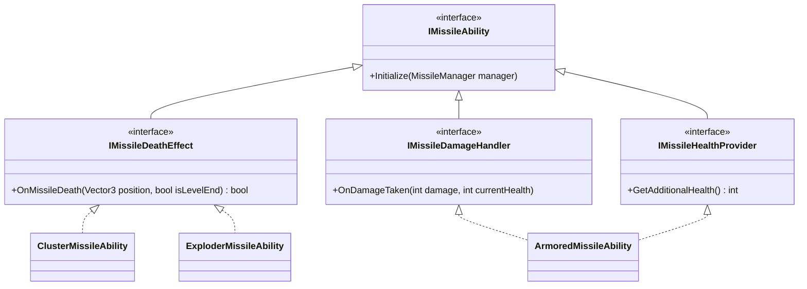

# AGENTS.md — BoomerangVsMissile AI Operational Guide

> **Project Identity:** `BoomerangVsMissile` (Product: `MissilesVsBoomerang`, Company: `OnurHan`)  
> **Engine & Target:** Unity `6000.2.13f1` (Unity 6) • Universal Render Pipeline (URP 17.2.0) • Mobile Portrait (Android & iOS) • 120 FPS Target  
> **Core Gameplay:** Hyper-casual arcade missile interceptor. Tap and drag to aim and charge curved boomerang throws; Catmull-Rom spline trajectory loops; bullet-time aiming; emergency recalls; ability-based ballistic missiles; store and stat progression.

---

## 1. High-Level Architecture Overview

The codebase is built on an **Observer / SignalBus Pattern** combined with **Command Pattern**, **Object Pooling**, and **Data-Driven ScriptableObject Architecture**. Direct coupling between subsystems (e.g. Player, Boomerang, Missiles, UI, Audio, Haptics) is strictly forbidden; communication flows exclusively through strongly typed signals.

```
                    ┌────────────────────────────────────────┐
                    │               InputManager             │
                    │   (Screen-to-world Ray, Hold & Drag)   │
                    └───────────────────┬────────────────────┘
                                        │ InputSignals
                                        ▼
┌──────────────────────┐      ┌─────────────────────┐      ┌─────────────────────────┐
│     LevelManager     │◄────►│   BoomerangManager  │◄────►│  MissileCreatorManager  │
│(Loads level prefabs) │      │(Aim, Spline, Recall)│      │(Clearance Check & Spawn)│
└──────────┬───────────┘      └──────────┬──────────┘      └────────────┬────────────┘
           │ CoreGameSignals             │ BoomerangSignals             │ MissileSignals
           ▼                             ▼                              ▼
┌────────────────────────────────────────────────────────────────────────────────────┐
│                                    SIGNAL BUS                                      │
│ CoreGameSignals • BoomerangSignals • MissileSignals • InputSignals • LevelSignals  │
│ PlayerSignals • ScoreSignals • PoolSignals • SaveSignals • UISignals • PitchSignals│
└──────┬──────────────────────┬────────────────────────┬──────────────────────┬──────┘
       │                      │                        │                      │
       ▼                      ▼                        ▼                      ▼
┌──────────────┐      ┌──────────────┐         ┌───────────────┐      ┌──────────────┐
│  UIManager   │      │ AudioManager │         │ PitchManager  │      │ TimeManager  │
│(HUD, Panels) │      │  (SFX / Pitch│         │(RichTap Haptic│      │(Slow-Mo Hit- │
│              │      │   Variations)│         │   Presets)    │      │ Stop Tween)  │
└──────────────┘      └──────────────┘         └───────────────┘      └──────────────┘
```

---

## 2. Directory Structure & Key Files

| Folder Path | Purpose & Key Components |
| :--- | :--- |
| [Assets/Scripts/Signals](file:///d:/Level_Up_Projects/BoomerangVsMissile/Assets/Scripts/Signals) | Strongly-typed decoupled event buses (`MonoSingleton<T>`). |
| [Assets/Scripts/Managers](file:///d:/Level_Up_Projects/BoomerangVsMissile/Assets/Scripts/Managers) | Core orchestrators managing game loop, spawning, pooling, progression, audio, and UI. |
| [Assets/Scripts/Controllers](file:///d:/Level_Up_Projects/BoomerangVsMissile/Assets/Scripts/Controllers) | Physical entity logic: Boomerang, Missile, Player, Camera, and UI panel handlers. |
| [Assets/Scripts/Commands](file:///d:/Level_Up_Projects/BoomerangVsMissile/Assets/Scripts/Commands) | Encapsulated discrete tasks: [SaveGameCommand](file:///d:/Level_Up_Projects/BoomerangVsMissile/Assets/Scripts/Commands/SaveGameCommand.cs), [LoadGameCommand](file:///d:/Level_Up_Projects/BoomerangVsMissile/Assets/Scripts/Commands/LoadGameCommand.cs), [EnumCastCommand](file:///d:/Level_Up_Projects/BoomerangVsMissile/Assets/Scripts/Commands/EnumCastCommand.cs). |
| [Assets/Scripts/Data/UnityObject](file:///d:/Level_Up_Projects/BoomerangVsMissile/Assets/Scripts/Data/UnityObject) | ScriptableObject definitions (`CD_*`) stored in `Assets/Resources/Data/`. |
| [Assets/Scripts/Data/ValueObject](file:///d:/Level_Up_Projects/BoomerangVsMissile/Assets/Scripts/Data/ValueObject) | Plain serializable C# classes holding tweakable game values (`*Data.cs`). |
| [Assets/Scripts/Enums](file:///d:/Level_Up_Projects/BoomerangVsMissile/Assets/Scripts/Enums) | Global type enumerations for states, sounds, pool objects, panels, and save keys. |
| [Assets/Scripts/Extensions](file:///d:/Level_Up_Projects/BoomerangVsMissile/Assets/Scripts/Extensions) | Utility singletons ([MonoSingleton](file:///d:/Level_Up_Projects/BoomerangVsMissile/Assets/Scripts/Extensions/MonoSingleton.cs)) and math helpers ([CatmullRomSpline](file:///d:/Level_Up_Projects/BoomerangVsMissile/Assets/Scripts/Extensions/CatmullRomSpline.cs)). |
| [Assets/Scripts/Interfaces](file:///d:/Level_Up_Projects/BoomerangVsMissile/Assets/Scripts/Interfaces) | Ability abstractions: [IMissileAbility](file:///d:/Level_Up_Projects/BoomerangVsMissile/Assets/Scripts/Interfaces/IMissileAbility.cs), `IMissileDeathEffect`, `IMissileDamageHandler`, `IMissileHealthProvider`. |
| [Assets/Resources/](file:///d:/Level_Up_Projects/BoomerangVsMissile/Assets/Resources) | Dynamic assets loaded via `Resources.Load`: levels, pool settings, audio clips, and data assets. |
| [Assets/Plugins/](file:///d:/Level_Up_Projects/BoomerangVsMissile/Assets/Plugins) | Third-party dependencies: Easy Save 3 (`ES3`), DOTween (`DG.Tweening`), RichTap Haptics SDK, AdMob. |

---

## 3. Core Subsystems & Mechanics

### 3.1. Signal Bus Architecture
All signal buses inherit from [MonoSingleton\<T\>](file:///d:/Level_Up_Projects/BoomerangVsMissile/Assets/Scripts/Extensions/MonoSingleton.cs) in namespace `Signals`.
- Delegates are pre-initialized with empty lambdas (e.g. `public UnityAction onPlay = delegate { };` or `public Func<int> onGetMoney = delegate { return 0; };`), preventing null pointer exceptions during invocation.
- Subscriptions should occur in `Awake()` or `OnEnable()`, and **must be unsubscribed in `OnDestroy()` or `OnDisable()`**.
- Always check `if (SignalBus.Instance != null)` before unsubscribing in `OnDestroy()` to avoid spawning dummy instances during scene teardown.

**Key Signals:**
- [CoreGameSignals](file:///d:/Level_Up_Projects/BoomerangVsMissile/Assets/Scripts/Signals/CoreGameSignals.cs): `onPlay`, `onReset`, `onLevelInitialize`, `onClearActiveLevel`, `onNextLevel`, `onRestartLevel`, `onLevelSuccessful`, `onLevelFailed`.
- [BoomerangSignals](file:///d:/Level_Up_Projects/BoomerangVsMissile/Assets/Scripts/Signals/BoomerangSignals.cs): `onBoomerangThrown`, `onBoomerangReturning`, `onBoomerangHasReturned`, `onBoomerangNextTarget`, `onCombo`, `onSetChargedArc`, `onBoomerangStatsChanged`, `onEmergencyRecall`, `onSelectBoomerang`.
- [MissileSignals](file:///d:/Level_Up_Projects/BoomerangVsMissile/Assets/Scripts/Signals/MissileSignals.cs): `onMissileDestroyed`, `onMissileArmorHit`, `onExploderMissileCreated`, `onExploderMissileDestroyed`, `onClusterSplit`.
- [InputSignals](file:///d:/Level_Up_Projects/BoomerangVsMissile/Assets/Scripts/Signals/InputSignals.cs): `onClicking`, `onInputReleased`, `onChargeUpdated`, `onChargeEnded`, `onEnableInput`, `onDisableInput`.
- [PoolSignals](file:///d:/Level_Up_Projects/BoomerangVsMissile/Assets/Scripts/Signals/PoolSignals.cs): `onGetObject`, `onGetObjectAtPosition`, `onGetObjectWithRotation`, `onSetParentAsPool`, `onAPoolObjectCreated`, `onPoolInitialized`.
- [ScoreSignals](file:///d:/Level_Up_Projects/BoomerangVsMissile/Assets/Scripts/Signals/ScoreSignals.cs): `onScoreIncrease`, `onScoreDecrease`, `onGetMoney`, `onGetScore`, `onHighScoreChanged`.
- [SaveSignals](file:///d:/Level_Up_Projects/BoomerangVsMissile/Assets/Scripts/Signals/SaveSignals.cs): `onSave`, `onBuyItem`, `onInitializeBoughtItems`, `onChangeSoundState`, `onChangePitchState`, `onGetScore`, `onGetSoundState`, `onGetPitchState`.
- [UISignals](file:///d:/Level_Up_Projects/BoomerangVsMissile/Assets/Scripts/Signals/UISignals.cs): `onOpenPanel`, `onClosePanel`, `onSetChangedText`.
- [PitchSignals](file:///d:/Level_Up_Projects/BoomerangVsMissile/Assets/Scripts/Signals/PitchSignals.cs): `onPlayPitch` (RichTap vibration presets).
- [AudioSignals](file:///d:/Level_Up_Projects/BoomerangVsMissile/Assets/Scripts/Signals/AudioSignals.cs): `onPlaySound`, `onPlaySoundWithPitch`.

---

### 3.2. Boomerang Flight Physics & Trajectory Engine
Orchestrated by [BoomerangManager](file:///d:/Level_Up_Projects/BoomerangVsMissile/Assets/Scripts/Managers/BoomerangManager.cs), [BoomerangMovementController](file:///d:/Level_Up_Projects/BoomerangVsMissile/Assets/Scripts/Controllers/Boomerang/BoomerangMovementController.cs), and [CatmullRomSpline](file:///d:/Level_Up_Projects/BoomerangVsMissile/Assets/Scripts/Extensions/CatmullRomSpline.cs).

1. **Aim & Charge Phase:**
   - [InputManager](file:///d:/Level_Up_Projects/BoomerangVsMissile/Assets/Scripts/Managers/InputManager.cs) raycasts to target tagged `Clickable`.
   - Holding down accumulates charge timer up to `ChargeDuration` in [PlayerData](file:///d:/Level_Up_Projects/BoomerangVsMissile/Assets/Scripts/Data/ValueObject/PlayerData.cs).
   - Horizontal drag relative to touch start controls the return arc swing direction (Drag left $\to$ swing right; Drag right $\to$ swing left).
   - [TrajectoryPreviewController](file:///d:/Level_Up_Projects/BoomerangVsMissile/Assets/Scripts/Controllers/Boomerang/TrajectoryPreviewController.cs) renders real-time direct line to target + Catmull-Rom return arc via `LineRenderer`.
   - [ChargeSliderController](file:///d:/Level_Up_Projects/BoomerangVsMissile/Assets/Scripts/Controllers/UI/ChargeSliderController.cs) floats a world-space charge HUD above the aimed missile.
2. **Sharp Direct Phase:**
   - On release (`onInputReleased`), boomerang flies straight toward target missile point with velocity proportional to `EffectiveSpeed + (chargeProgress * 10)`.
   - Fully charged throws (`progress >= 0.99f`) deal 2 damage upon collision instead of 1.
3. **Smooth Return Arc Phase:**
   - Once target point is reached or upon missile collision, boomerang shifts to return flight.
   - Generates control points: `[currentPos, target, apexPoint, midDescentPoint, initializePos]` and passes them to [CatmullRomSpline](file:///d:/Level_Up_Projects/BoomerangVsMissile/Assets/Scripts/Extensions/CatmullRomSpline.cs).
   - Speed during return = `EffectiveSpeed * (1 + EffectiveReturnSpeedMultiplier)`.
4. **Extra Return Arc Swing (Multi-Hit):**
   - If the returning boomerang strikes another missile before reaching player, it reverses swing direction and builds a fresh sub-arc, chaining hits into combos.
5. **Emergency Recall:**
   - While boomerang is airborne, tapping the screen immediately triggers `onEmergencyRecall`.
   - Boomerang aborts spline flight and sprints directly toward player grip position at amplified velocity.

---

### 3.3. Missile Ability Architecture
Missiles are driven by [MissileManager](file:///d:/Level_Up_Projects/BoomerangVsMissile/Assets/Scripts/Managers/MissileManager.cs) and specialized interface components in [Controllers.Missile.Abilities](file:///d:/Level_Up_Projects/BoomerangVsMissile/Assets/Scripts/Controllers/Missile/Abilities):



- **[ArmoredMissileAbility](file:///d:/Level_Up_Projects/BoomerangVsMissile/Assets/Scripts/Controllers/Missile/Abilities/ArmoredMissileAbility.cs):** Grants bonus health (`IMissileHealthProvider`), plays metallic deflection audio `ShieldBroke`, punches scale via DOTween, triggers armor flash, and raises `onMissileArmorHit`.
- **[ClusterMissileAbility](file:///d:/Level_Up_Projects/BoomerangVsMissile/Assets/Scripts/Controllers/Missile/Abilities/ClusterMissileAbility.cs):** On death (`IMissileDeathEffect`), spawns sub-missiles via [PoolManager](file:///d:/Level_Up_Projects/BoomerangVsMissile/Assets/Scripts/Managers/PoolManager.cs) with configured spacing and optional spawn delay.
- **[ExploderMissileAbility](file:///d:/Level_Up_Projects/BoomerangVsMissile/Assets/Scripts/Controllers/Missile/Abilities/ExploderMissileAbility.cs):** Uses downward `OverlapBox` raycast clearance checking before entering play. On death, detonates all missiles within `ExplosionRadius` using an `OverlapSphere`.
- **Extending Missiles:** When creating new missile behaviors, implement [IMissileAbility](file:///d:/Level_Up_Projects/BoomerangVsMissile/Assets/Scripts/Interfaces/IMissileAbility.cs) sub-interfaces. **Do not bloat [MissileManager](file:///d:/Level_Up_Projects/BoomerangVsMissile/Assets/Scripts/Managers/MissileManager.cs)**.

---

### 3.4. Missile Spawning & Anti-Overlap System
[MissileCreatorManager](file:///d:/Level_Up_Projects/BoomerangVsMissile/Assets/Scripts/Managers/MissileCreatorManager.cs) handles level waves:
- Reads level config from [CD_MissileCreator](file:///d:/Level_Up_Projects/BoomerangVsMissile/Assets/Scripts/Data/UnityObject/CD_MissileCreator.cs).
- Selects missile types using cumulative percentage intervals (`_rangeList`).
- **Clearance Validation:** Ensures newly spawned missiles never collide or overlap at spawn time via:
  1. Living missile proximity distance check (`horizontalClearance = 1.0f`, `verticalClearance = 2.5f`).
  2. Physics `OverlapBox` test over the clearance corridor.
  3. 20-sample fallback scanning to pick the least congested horizontal coordinate.
- Win condition evaluates destroyed count against `MissileCount + AdditionalClusterCount`.

---

### 3.5. Time Manipulation & Game Feel
[TimeManager](file:///d:/Level_Up_Projects/BoomerangVsMissile/Assets/Scripts/Managers/TimeManager.cs) manages game temporal scaling:
- **Aiming Slow-Mo:** When holding down on a clickable missile, `Time.timeScale` drops to `ClickingTimeScale` (0.2f).
- **Hit-Stop:** Upon missile impact or armor hit, `Time.timeScale` drops to `HitStopTimeScale` (0.05f) for `HitStopDuration` (0.06s) via `DOVirtual.DelayedCall(..., true)` using unscaled time.
- **Camera Shake:** [CameraShakeController](file:///d:/Level_Up_Projects/BoomerangVsMissile/Assets/Scripts/Controllers/Camera/CameraShakeController.cs) binds automatically to Main Camera on scene load and executes `DOShakePosition` with unscaled delta time.

---

### 3.6. Object Pooling Architecture
Managed by [PoolManager](file:///d:/Level_Up_Projects/BoomerangVsMissile/Assets/Scripts/Managers/PoolManager.cs) via [PoolSignals](file:///d:/Level_Up_Projects/BoomerangVsMissile/Assets/Scripts/Signals/PoolSignals.cs):
- Configured via ScriptableObjects [CD_PoolSettings](file:///d:/Level_Up_Projects/BoomerangVsMissile/Assets/Scripts/Data/UnityObject/CD_PoolSettings.cs) (`DefaultPoolSettings.asset`).
- Pool warmup distributes instantiations across frames (`yield return null` every 10 objects) and broadcasts progress via `onAPoolObjectCreated`.
- Supported pooled objects: [PoolEnums](file:///d:/Level_Up_Projects/BoomerangVsMissile/Assets/Scripts/Enums/PoolEnums.cs) (`Missile_1_Default` ... `Missile_6_Cluster_Small`, `ExplosionStandard`, `ExplosionPink`, `Confetti`).
- Pools dynamically expand if exhausted and completely reset transforms/velocities on level reset.

---

### 3.7. Save & Progression System
Persistence is powered by **Easy Save 3 (`ES3`)**:
- Files:
  - `SaveFile.es3`: Player level, money balance, high score, unlocked boomerangs, and upgrade tiers (`Upgrade_Speed`, `Upgrade_ReturnSpeed`, `Upgrade_Size`).
  - `GameOptions.es3`: Sound toggle state, Pitch (haptics) toggle state.
- [BoomerangUpgradeManager](file:///d:/Level_Up_Projects/BoomerangVsMissile/Assets/Scripts/Managers/BoomerangUpgradeManager.cs) exposes stat queries and purchase verification via [CD_BoomerangUpgrades](file:///d:/Level_Up_Projects/BoomerangVsMissile/Assets/Scripts/Data/UnityObject/CD_BoomerangUpgrades.cs).
- Upgrades immediately reflect in gameplay via `BoomerangSignals.Instance.onBoomerangStatsChanged`.

---

### 3.8. Haptics & Audio
- **Haptics:** [PitchManager](file:///d:/Level_Up_Projects/BoomerangVsMissile/Assets/Scripts/Managers/PitchManager.cs) maps [PitchEnums](file:///d:/Level_Up_Projects/BoomerangVsMissile/Assets/Scripts/Enums/PitchEnums.cs) (`Explosion`, `Click`, `Combo`, `Hit`, `Win`, `Lose`, `ShieldBroke`) to `RichtapPreset` vibrations (`RT_BOMB`, `RT_SUCCESS`, `RT_THUD`, `RT_VICTORY`, `RT_FAILURE`, `RT_REJECT`).
- **Audio:** [AudioManager](file:///d:/Level_Up_Projects/BoomerangVsMissile/Assets/Scripts/Managers/AudioManager.cs) pools multi-source SFX playback using [AudioSoundEnums](file:///d:/Level_Up_Projects/BoomerangVsMissile/Assets/Scripts/Enums/AudioSoundEnums.cs) with dynamic pitch scaling for combo streaks.

---

## 4. Coding Standards & Conventions

When writing or modifying C# scripts in this repository, strictly adhere to the following rules:

### 4.1. File Organization & Variable Regions
Maintain standard `#region` layouts in all MonoBehaviour classes:

```csharp
namespace Controllers.Boomerang
{
    public class ExampleController : MonoBehaviour
    {
        #region Self Variables

        #region Public Variables
        public bool IsActive => _isActive;
        #endregion

        #region Serialized Variables
        [SerializeField] private float speedMultiplier = 1.0f;
        #endregion

        #region Private Variables
        private bool _isActive;
        private Rigidbody _rigidbody;
        #endregion

        #endregion

        private void Awake()
        {
            Init();
            SubscribeEvents();
        }

        private void Init()
        {
            _rigidbody = GetComponent<Rigidbody>();
        }

        #region Event Subscription
        private void SubscribeEvents()
        {
            CoreGameSignals.Instance.onPlay += OnPlay;
        }

        private void UnsubscribeEvents()
        {
            if (CoreGameSignals.Instance != null)
            {
                CoreGameSignals.Instance.onPlay -= OnPlay;
            }
        }

        private void OnDestroy()
        {
            UnsubscribeEvents();
        }
        #endregion

        private void OnPlay()
        {
            _isActive = true;
        }
    }
}
```

### 4.2. Naming Conventions
- **Classes, Structs, Enums, Interfaces, Public Properties & Methods:** `PascalCase`.
- **Interfaces:** Must begin with prefix `I` (e.g. `IMissileAbility`).
- **ScriptableObjects:** Prefix with `CD_` (e.g. [CD_Player](file:///d:/Level_Up_Projects/BoomerangVsMissile/Assets/Scripts/Data/UnityObject/CD_Player.cs)).
- **Value Objects:** Suffix with `Data` (e.g. [PlayerData](file:///d:/Level_Up_Projects/BoomerangVsMissile/Assets/Scripts/Data/ValueObject/PlayerData.cs)).
- **Private / Protected Fields:** `_camelCase` with leading underscore (e.g. `_isReturning`, `_data`).
- **Serialized Private Fields:** `camelCase` without underscore (e.g. `[SerializeField] private float speed;`).
- **Constants:** `PascalCase` or `ALL_CAPS`.

### 4.3. Unity API Guidelines
- Use modern Unity 6 / 2023+ APIs:
  - Prefer `FindFirstObjectByType<T>()` / `FindObjectsByType<T>(FindObjectsSortMode.None)` over deprecated `FindObjectOfType<T>()`.
  - Use `_rigidbody.linearVelocity` instead of `_rigidbody.velocity` (Unity 6 physics standard).
- Never place hardcoded asset string paths in deep logic without fallbacks or centralization.
- Always check component existence before using (`GetComponent` or `TryGetComponent`).

---

## 5. Critical Tags & Layers

Configured in [ProjectSettings/TagManager.asset](file:///d:/Level_Up_Projects/BoomerangVsMissile/ProjectSettings/TagManager.asset):

| Tag | Purpose |
| :--- | :--- |
| `Missile` | Ballistic missile colliders targeted by boomerang. |
| `Boomerang` | Active boomerang physics collider. |
| `BoomerangHand` | Player avatar hand grip target point. |
| `Clickable` | Targetable missiles detected by touch raycast. |
| `SafeArea` | Bottom threshold collider; trigger fail when reached by missile. |
| `CatchArea` | Player retrieval zone resetting boomerang state. |
| `ScreenBox` | Boundary container for viewport clamping. |

---

## 6. Build, Run & Development Workflow

### 6.1. Scene Setup
- **Main Game Scene:** [Assets/Scenes/MainScene.unity](file:///d:/Level_Up_Projects/BoomerangVsMissile/Assets/Scenes/MainScene.unity) (Build index `0`).
- **Tutorial Scene:** [Assets/Scenes/TutorialScene.unity](file:///d:/Level_Up_Projects/BoomerangVsMissile/Assets/Scenes/TutorialScene.unity).

### 6.2. Editor Tools
- **Boomerang Material Designer:**  
  Path: `Tools > Boomerang > Design Boomerang Materials`  
  Implemented in [BoomerangMaterialDesigner.cs](file:///d:/Level_Up_Projects/BoomerangVsMissile/Assets/Scripts/Editor/BoomerangMaterialDesigner.cs). Automatically inspects 3D models in `Assets/Art/Models`, binds URP Lit materials, generates normal and emission textures, and assigns them to weapon models.

---

## 7. AI Agent Operational Rules & Guardrails

When working on this repository, all AI agents **MUST** respect the following constraints:
1. **Conform to Established Architecture:**
   - Integrate new features into the existing Signal / Manager / Controller / Data structure.
   - Do not bypass signals to create tight coupling between components.
2. **Minimal Disruption Principle:**
   - Modify only what has been explicitly requested.
   - Preserve existing comments, docstrings, and animator event callbacks (e.g. [PlayerAnimatorEvent.cs](file:///d:/Level_Up_Projects/BoomerangVsMissile/Assets/Scripts/AnimatorEvents/PlayerAnimatorEvent.cs)).
3. **Safety First:**
   - If any change has the potential to break scene references, prefab links, or save files, **request user permission before proceeding**.
4. **Documentation Compliance:**
   - Maintain forward-slash clickable markdown links with `file:///` format for all mentioned scripts and assets.
